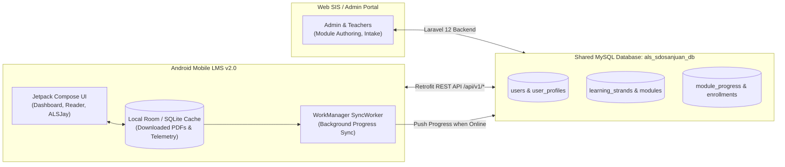

# DepEd SDO San Juan Alternative Learning System (ALS) — Android Modular LMS
### Native Offline-First Mobile Learning Management System for Learners

[](https://github.com/Renren051/als_sdosanjuan_modules_apk)
[](https://kotlinlang.org/)
[](https://developer.android.com/jetpack/compose)
[](https://m3.material.io/)
[](https://developer.android.com/training/data-storage/room)
[](https://square.github.io/retrofit/)
[-success?style=flat)]()

---

## 📌 Application Overview

The **DepEd SDO San Juan Alternative Learning System (ALS) Mobile LMS (v2.0)** is a native Android application engineered specifically for Out-of-School Youth and Adults (OSYA). Designed under **Republic Act No. 11510**, it enables self-paced learning across San Juan City with **robust offline-first capabilities**.

Built using modern **Android Jetpack Compose**, **MVVM Clean Architecture**, and **Material 3 Design**, the mobile application connects to the centralized **Laravel 12 Backend API**, sharing the exact same central database as the Web Student Information System (SIS).

---

## 🗄️ Single Shared Database Architecture

The Android Mobile App and the Web SIS / LMS do **not** have separate databases. Both applications operate against the **exact same MySQL database** (`als_sdosanjuan_db`):



### Real-Time Synchronisation Guarantees:
1. **Instant Account Sharing:** Learners registered online via the Web Intake Wizard (DepEd Form 2) can immediately log into the Android app using their credentials.
2. **Instant Module Publishing:** When an Administrator uploads or updates an official DepEd Self-Learning Module (SLM) on the Web SIS, the Android app receives the new module, title, and file link immediately upon refreshing the dashboard.
3. **Offline Telemetry & Cloud Synchronization:** 
   - When a learner reads a module without internet, their reading progress (`last_page_read`, completion status, timestamp) is recorded securely into local SQLite/Room storage.
   - As soon as the device reconnects to Wi-Fi or mobile data, the Android `SyncWorker` automatically transmits the data to `/api/v1/learner/sync-progress` on the backend, updating the teacher and administrator web views in real time.

---

## 🚀 Key Features & Highlights (v2.0)

### 1. Animated Frosted-Glass Login Screen
- **Tri-Image Cinematic Transitions:** Smooth, continuous looping background featuring 3 high-resolution educational photographs (`forbg.jpg`, `forbg1.jpg`, `forbg3.jpg`).
- **Alternating Ken Burns Pan Motion:** Slides transition gracefully with alternating pan directions (Left to Right, then Right to Left) with crossfades.
- **Hardware-Accelerated Blur & Frosted Card:** Modern frosted-glass card (`Modifier.blur(18.dp)`), institutional DepEd branding, and interactive password visibility toggle.

### 2. Track-Scoped Curriculum & Real-Time Strand Chips
- **Automatic Track Filtering:** Learners only see curriculum modules tailored to their enrolled track:
  - **Basic Literacy Program (BLP)**
  - **A&E Elementary (Grades 1–6)** — including Lower (Grades 1–3) and Advanced (Grades 4–6) in English & Filipino
  - **A&E Junior High School (Grades 7–10)**
- **Interactive Strand Chips (LS1 to LS6):** Displays the 6 official DepEd Learning Strands with dynamic module counters (e.g., `LS1 Communication (12)`).
- **Instant Search Bar:** Filter modules in real time by keywords with a 1-tap clear button.

### 3. Offline Module Reader & Local Storage
- **1-Tap Offline Caching:** Download official DepEd PDF modules directly to secure private app storage.
- **Emerald Status Indicators:** Downloaded modules display an emerald green status badge, indicating they can be opened without an active internet connection.
- **Integrated PDF Viewer:** High-performance in-app reading with swipe page navigation, pinch-to-zoom, and automatic last-read page saving.

### 4. Background Telemetry Synchronization
- **WorkManager Automation:** Periodically checks network state and dispatches pending reading milestones to the shared MySQL database via `/api/v1/learner/sync-progress`.
- **Zero Data Loss:** Reading timestamps and progress are preserved even if the app is closed or the device runs out of battery.

### 5. ALSJay — DepEd AI Virtual Assistant
- Bilingual chatbot (Tagalog & English) answering learner inquiries about ALS requirements, schedules, and learning centers.
- Quick suggestion chips for common questions (e.g., *"Paano po mag-enroll sa ALS?"*, *"Ano ang mga Learning Strands?"*).

---

## 🛠️ Prerequisites & Tools

- **Android Studio:** Ladybug, Koala, Iguana, or 2024.1+
- **Java Development Kit (JDK):** JDK 17 (recommended for Gradle 8+)
- **Android SDK:**
  - Minimum SDK: **API 24** (Android 7.0 Nougat)
  - Target / Compile SDK: **API 37**
- **Laravel Backend:** Running locally or hosted on your network (see network setup below).

---

## 🌐 Network Configuration (Connecting to Host PC Backend)

Because both systems share the same database, the Android app makes API requests to the Laravel backend running on your host computer.

### Step 1: Start Laravel with Host Binding
On your host PC, start the Laravel server in PowerShell:
```powershell
php artisan serve --host=0.0.0.0 --port=8000
```
*(Do NOT omit `--host=0.0.0.0` — otherwise physical devices on your network cannot connect).*

### Step 2: Find Your PC's Local IP Address
In PowerShell, run:
```powershell
ipconfig
```
Find the **IPv4 Address** of your active Wi-Fi adapter (e.g., `192.168.1.15`).

### Step 3: Configure `Constants.kt`
Open the file in Android Studio:
```
app/src/main/java/com/jannlawm/alssdosanjuan/data/remote/Constants.kt
```
Configure the URLs according to your testing environment:

```kotlin
package com.jannlawm.alssdosanjuan.data.remote

object Constants {
    // For Physical Device (Replace with your host PC's Wi-Fi IP address):
    const val BASE_URL_DEVICE = "http://192.168.1.15:8000/api/v1/"

    // For Android Emulator (10.0.2.2 maps to host PC's localhost):
    const val BASE_URL_EMULATOR = "http://10.0.2.2:8000/api/v1/"

    // Set active base URL (Set to BASE_URL_DEVICE for real phones, or BASE_URL_EMULATOR for emulator):
    var currentBaseUrl: String = BASE_URL_DEVICE
}
```

> [!TIP]
> Ensure your physical Android smartphone and your PC are connected to the **exact same Wi-Fi network**. If your phone cannot connect, verify that Windows Defender Firewall allows incoming connections on port `8000`.

---

## 📦 How to Build & Generate the APK

### Method 1: Ready-to-Install Prebuilt APK (v2.0)
A standalone, fully compiled release APK is pre-generated in the repository root:
```
ALSSDOSanJuan_v2.0.apk
```
You can transfer this APK directly to your Android device via USB, Google Drive, or Bluetooth and tap to install.

### Method 2: Command Line Build (Gradle)
From the root directory of the Android project:

**Windows (PowerShell):**
```powershell
.\gradlew.bat assembleDebug
```

**Mac / Linux:**
```bash
./gradlew assembleDebug
```

The compiled APK will be generated at:
```
app/build/outputs/apk/debug/app-debug.apk
```

### Method 3: Via Android Studio IDE
1. Open the project folder in **Android Studio**.
2. Wait for Gradle Sync to complete.
3. In the menu bar, navigate to **Build > Build APK(s) / Bundle(s) > Build APK(s)**.
4. When compilation completes, click the **locate** popup notification to open the output directory.

---

## 📲 How to Install & Run on Device or Emulator

### Option A: Install via ADB (USB Debugging)
Connect your physical phone via USB with **USB Debugging** enabled, then run:
```powershell
adb install -r ALSSDOSanJuan_v2.0.apk
```

### Option B: Run Directly from Android Studio
1. Connect your Android device via USB or start an Android Virtual Device (AVD).
2. Select your device from the target device dropdown in the toolbar.
3. Click the green **Run** button or press Shift + F10.

---

## 👥 Seeded Demo Learner Accounts

Log in with any of these pre-seeded learner accounts from the shared database:

| Program Track | Username | Password | Learner Reference Number (LRN) | Notes |
| :--- | :--- | :--- | :--- | :--- |
| **Basic Literacy (BLP)** | `learner_blp` | `Password123!` | `136542240010` | Shows Basic Literacy modules |
| **A&E Elementary** | `learner_elem` | `Password123!` | `136542240020` | Shows Elementary modules (Lower & Advanced) |
| **A&E Junior High** | `learner_jhs` | `Password123!` | `136542240030` | Shows Junior High School modules |
| **General Learner** | `learner_mark` | `Password123!` | `136542240001` | Enrolled JHS learner with sample progress |

---

## 📖 How to Use the Android App

### 1. Signing In
1. Launch the app. You will see the cinematic background photo loop.
2. Enter your **Username** or **LRN** and **Password** (e.g., `learner_elem` / `Password123!`).
3. Tap the eye icon to toggle password visibility.
4. Tap **"Mag-login"**. Upon successful authentication, your Sanctum Bearer token is saved into `EncryptedSharedPreferences`.

### 2. Exploring the Dashboard
1. The dashboard automatically displays your enrolled track (e.g., *Alternative Learning System — Elementary*).
2. Tap any of the **Learning Strand Chips** at the top (`All`, `LS1 Communication`, `LS2 Scientific Thinking`, etc.) to filter modules.
3. The count next to each chip indicates how many modules are currently published in that strand for your curriculum track.
4. Use the search bar to find modules by keyword. Tap the clear button to reset.

### 3. Downloading Modules for Offline Reading
1. Tap the download icon on any module card.
2. The app streams the PDF from `/api/v1/modules/{id}/download` and saves it to internal app storage.
3. An **emerald green "Downloaded" badge** appears on the card.
4. You can now open and study this module anytime—even in airplane mode or in remote areas with zero cell coverage!

### 4. Reading Modules & Telemetry Tracking
1. Tap any downloaded module card to open the **In-App PDF Reader**.
2. Swipe vertically or horizontally to turn pages.
3. Pinch to zoom in on detailed diagrams and text.
4. When you exit, the app automatically remembers your **last page read**.

### 5. Automatic Background Telemetry Sync
1. You do not need to do anything manually!
2. Whenever your device connects to Wi-Fi or mobile data, the `SyncWorker` sends your progress records to the shared database.
3. Your assigned Mobile Teacher can immediately see your completed modules on their Web SIS portal.

### 6. Asking Questions with ALSJay AI
1. Tap the chat icon in the navigation bar to open **ALSJay**.
2. Tap a suggestion chip or type your question in Tagalog or English.
3. Receive instant answers on ALS policies, graduation requirements, and schedules.

---

## 🏗️ Project Architecture & Source Code Structure

```
com.jannlawm.alssdosanjuan
├── data
│   ├── local
│   │   ├── AppDbHelper.kt            # SQLite / Room database helper
│   │   └── TokenManager.kt           # EncryptedSharedPreferences for auth tokens
│   ├── model
│   │   ├── AuthModels.kt             # User & Login response models
│   │   ├── ModuleModels.kt           # Strand & Module data classes with counters
│   │   ├── TelemetryModels.kt        # Offline progress records
│   │   └── ChatModels.kt             # ALSJay chat payload models
│   ├── remote
│   │   ├── ApiClient.kt              # Retrofit & OkHttpClient configuration
│   │   ├── ApiService.kt             # REST API endpoint interfaces
│   │   ├── AuthInterceptor.kt        # Bearer token injection header interceptor
│   │   └── Constants.kt              # Base URL configuration (Device vs Emulator)
│   ├── repository
│   │   ├── AuthRepository.kt         # Authentication & profile management
│   │   ├── ModuleRepository.kt       # Module fetching, caching, and filtering
│   │   ├── TelemetryRepository.kt    # Progress tracking & sync logic
│   │   └── ChatRepository.kt         # ALSJay AI chat interaction
│   └── worker
│       └── SyncWorker.kt             # WorkManager background sync task
├── ui
│   ├── chat
│   │   ├── ChatScreen.kt             # ALSJay chat interface with quick chips
│   │   └── ChatViewModel.kt          # Message state handling
│   ├── dashboard
│   │   ├── DashboardScreen.kt        # Hero track card, search, strand chips, module list
│   │   └── DashboardViewModel.kt     # Curriculum filtering & module state
│   ├── login
│   │   ├── LoginScreen.kt            # Cinematic Ken Burns background & frosted login card
│   │   └── LoginViewModel.kt         # Authentication validation & state
│   ├── module
│   │   ├── ModuleReaderScreen.kt     # In-app PDF reader with zoom & page saving
│   │   └── ModuleViewModel.kt        # PDF streaming & local caching logic
│   └── theme
│       ├── Color.kt                  # Official DepEd Blue, Red, Yellow & Neutrals
│       ├── Theme.kt                  # Material 3 Dynamic Light/Dark Theme
│       └── Type.kt                   # Typography definitions
└── MainActivity.kt                   # NavHost navigation & app lifecycle entry
```

---

## ⚖️ Legal & Attribution

- **Department of Education (DepEd)** — Republic of the Philippines
- **Schools Division Office of San Juan City** — Alternative Learning System Unit
- Developed in compliance with **RA 11510 (The Alternative Learning System Act)** and **RA 10173 (Data Privacy Act of 2012)**.
